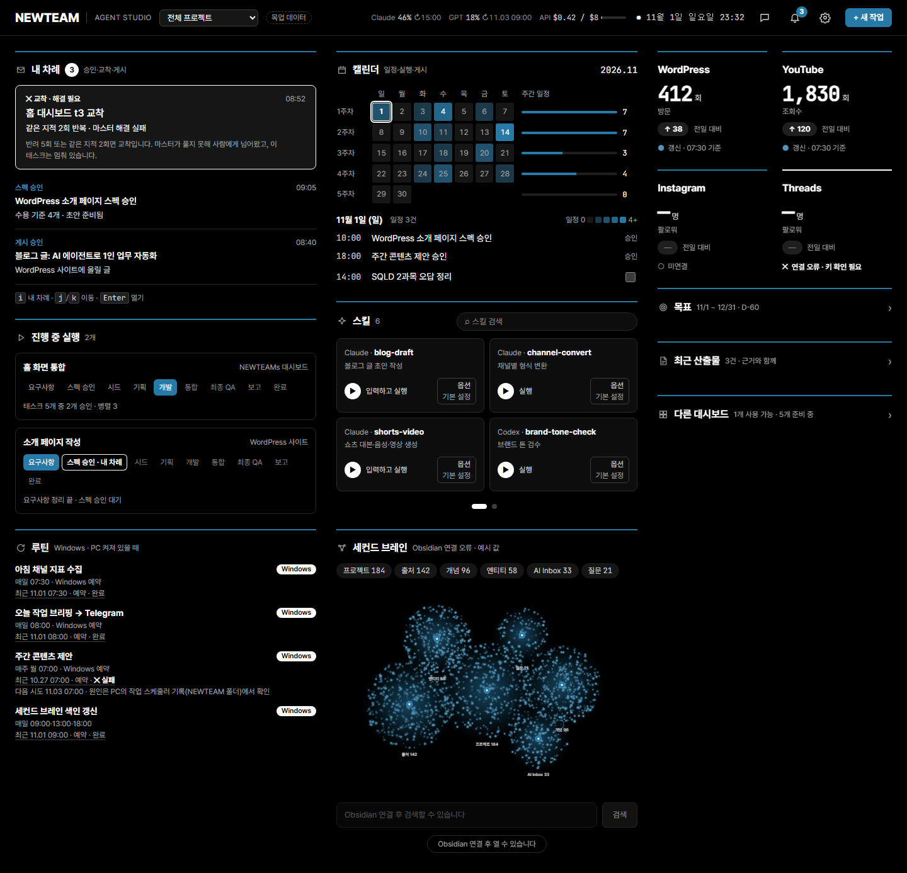
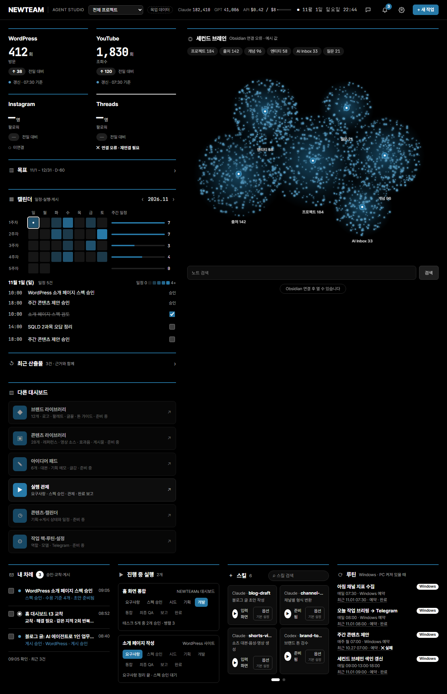
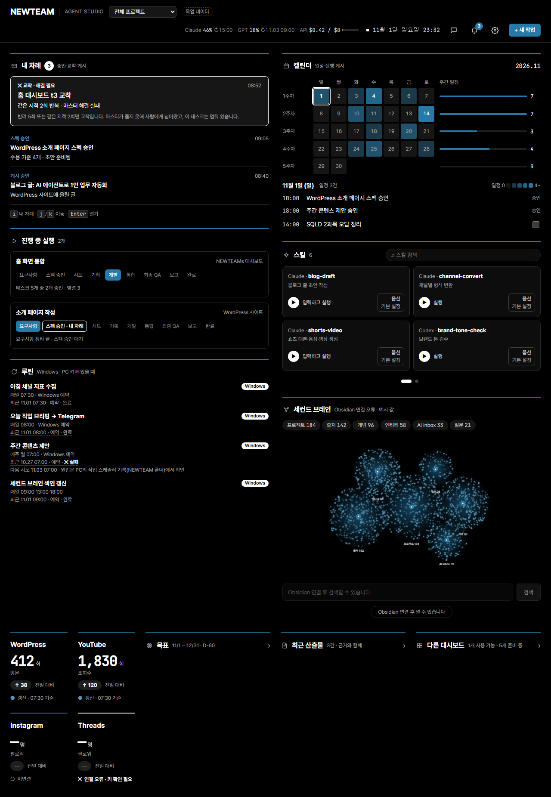

# NEWTEAMs

> AI가 일을 대신하는 동안, 사람은 **지금 어디까지 왔는지·왜 멈췄는지·내가 무엇을 결정해야 하는지**만 빠르게 파악할 수 있도록 만든 로컬 AI 에이전트 운영 시스템입니다.



## 프로젝트 한눈에 보기

| 구분 | 내용 |
| --- | --- |
| 프로젝트 유형 | 개인 프로젝트 · 로컬 웹 애플리케이션 |
| 목표 사용자 | 여러 AI 에이전트의 작업을 혼자 운영하는 기획·개발 실무자 |
| 해결하려는 문제 | 자동화가 길어질수록 커지는 진행 불안, 개입 피로, 결과에 대한 불신 |
| 핵심 경험 | 관제 → 필요한 순간만 개입 → 근거를 따라 결과 검증 |
| 주요 범위 | 문제 정의, 사용자 시나리오, 운영 정책, 대시보드 UX, 오케스트레이터, 테스트 |
| 기술 | React, TypeScript, Vite, Node.js, Fastify, Vitest, Playwright |
| 현재 단계 | 로컬 프로토타입 · 실제 사용자 성과 측정 전 |

## 왜 만들었나

AI 에이전트가 기획부터 개발, 검수까지 맡더라도 사용자의 일이 완전히 사라지지는 않습니다. 오히려 작업이 보이지 않으면 다음 질문이 반복됩니다.

- 지금도 정상적으로 진행 중인가?
- 같은 문제를 계속 반복하고 있지는 않은가?
- 내가 개입해야 하는 순간인가?
- 완료됐다는 결과를 무엇을 근거로 믿을 수 있는가?

NEWTEAMs는 이 문제를 “더 많은 자동화”가 아니라 **더 적은 개입으로도 안심할 수 있는 운영 경험**으로 풀었습니다. 시스템은 평소 조용히 일하고, 사람의 판단이 필요한 순간만 분명하게 드러냅니다.

## CX 목표

제품의 성공 기준을 기능 수가 아닌 사용자가 답을 얻는 시간으로 정의했습니다.

| 사용 장면 | 사용자가 얻어야 하는 답 | 목표 경험 |
| --- | --- | --- |
| 다른 일을 하다가 화면을 잠깐 확인 | 진행 중인가, 막혔나, 내 차례인가 | 핵심 상태를 2초 안에 파악 |
| 자리를 비웠다가 복귀 | 그사이 무엇이 끝나고 되돌아갔나 | 이벤트를 하나씩 열지 않고 1분 안에 따라잡기 |
| 같은 문제가 반복되는 교착 상황 | 무엇을 시도했고 무엇을 결정해야 하나 | 원인 확인부터 지침 전송까지 3분 이내 |
| 완료 결과 검토 | 수용 기준을 실제로 충족했나 | 주장마다 테스트·캡처·원본 판정을 연결 |

## 핵심 설계

### 1. 자동화보다 먼저 보이는 관제

대시보드의 첫 화면은 기능 메뉴보다 현재 단계, 주의가 필요한 항목, 사용량을 먼저 보여 줍니다. 사용자는 상세 로그를 읽기 전에 “지금 괜찮은가”를 판단할 수 있습니다.

### 2. 사람이 할 일만 모은 결정 큐

스펙 승인, 파이프라인 시작, 교착 해결처럼 사람의 판단이 필요한 항목만 오래 기다린 순서로 모았습니다. 결정할 일이 없을 때는 에이전트가 진행 중이라는 사실을 명확히 알려 불필요한 확인을 줄였습니다.

### 3. 요약에서 원본까지 이어지는 신뢰 구조

사람용 타임라인과 AI 원본 로그를 분리하되 서로 연결했습니다. 완료·승인 같은 상태에는 테스트, 캡처, 판정 근거를 붙이고, 사용자는 요약 → 근거 → 원본 순서로 판단 과정을 추적할 수 있습니다.

### 4. 개입은 드물고, 되돌리기 어려운 결정은 한 번 더 확인

자동으로 풀리는 사용량 제한은 사람을 호출하지 않습니다. 반면 로그인 만료, 반복 반려, 태스크 건너뛰기처럼 실제 판단이나 영향 범위가 있는 상황은 별도 주의 카드와 확인 단계로 다룹니다.

### 5. 서로 다른 모델로 교차 검증

Claude 계열 에이전트가 작업하고 GPT 계열 검수자가 읽기 전용으로 결과를 판정합니다. 같은 모델이 자신의 결과를 스스로 승인하는 구조를 피하고, 최종 통합 단계에서는 새 검수 세션으로 전체를 다시 확인합니다.

## 사용자 흐름

```text
요구사항 대화
   ↓
스펙 승인 ── 사람의 첫 번째 결정
   ↓
계획 수립 ⇄ GPT 검수
   ↓
개발 ⇄ 테스트·QA ⇄ GPT 검수
   ↓          ↘ 반복 실패 시 마스터 → 사람에게 교착 전달
통합 → 최종 QA → 근거가 연결된 보고서
```

사람은 스펙을 승인하고, 자동 해결이 어려운 교착을 풀고, 최종 결과를 검토합니다. 나머지 과정은 역할별 에이전트와 검수 루프가 맡습니다.

## 주요 기능

- 프로젝트 단계와 병렬 태스크를 실시간으로 보여 주는 관제 대시보드
- 사람의 판단이 필요한 항목만 모은 결정 큐와 주의 카드
- 반복 반려를 감지해 마스터 또는 사람에게 넘기는 교착 규칙
- 테스트·브라우저 캡처·검수 판정을 요구하는 증거 기반 승인
- 사람용 요약과 원본 이벤트 로그를 연결한 추적 구조
- 사용량 제한 시 자동 일시정지·재개, API 비용 하드 캡
- 데스크톱을 벗어나도 승인과 지침을 처리할 수 있는 Telegram 연동
- Vault 기반 지식·결정 기록과 역할별 컨텍스트 구성
- 로컬 실행, Host·Origin 제한, 에이전트 설정 격리 등 보안 장치

## 과정에서 내린 주요 결정

| 결정 | 이유 | CX 효과 |
| --- | --- | --- |
| 파이프라인 시작은 항상 사람이 수행 | 실제 모델 호출과 비용이 발생하기 때문 | 의도하지 않은 실행 방지 |
| 반려 한도를 5회에서 3회로 축소 | 반복 루프의 비용과 대기 시간이 큼 | 교착을 더 일찍 드러냄 |
| 소리 알림은 사람이 필요할 때만 사용 | 모든 상태 변화를 알리면 중요한 신호가 묻힘 | 알림 피로 감소 |
| 사람용 기록과 원본 로그를 분리·연결 | 읽기 쉬움과 검증 가능성을 함께 확보해야 함 | 빠른 이해와 신뢰 형성 |
| 태스크 중단 대신 현재 작업 완료 후 정지 | 중간 종료는 작업 폴더를 불완전하게 만들 수 있음 | 데이터 손실 위험 감소 |
| 비용과 사용량을 화면에 상시 노출 | 자동화 과정의 통제감을 유지해야 함 | 예측 가능한 운영 |

## 검증

화면보다 먼저 8개의 사용자 시나리오를 정의하고, 각 시나리오가 E2E 테스트로 이어지도록 설계했습니다. 정상 진행뿐 아니라 교착, 사용량 제한, 로그인 만료, 연결 끊김, 중복 응답 같은 예외 상황도 포함했습니다.

2026년 11월 2일 인계 기록 기준:

- 오케스트레이터 테스트 414개 통과, Windows 심볼릭 링크 관련 1개 건너뜀
- 대시보드 테스트 174개 통과
- 대시보드 프로덕션 빌드 성공

> 위 결과는 제품 사용 성과가 아닌 구현 검증 결과입니다. 실제 사용 데이터와 사용자 사례는 아직 수집 전이며, 화면의 예시 데이터도 목업입니다.

## 화면 비교

| 개선 전 | 개선 후 |
| --- | --- |
|  |  |

개선 후에는 목표와 진행 상태, 사람이 확인할 항목, 스킬·루틴을 역할에 따라 재배치했습니다. 장시간 켜 두는 화면이라는 사용 맥락을 고려해 큰 움직임과 불필요한 강조를 줄이고, 필요한 신호만 눈에 띄도록 조정했습니다.

## 기술 구조

```text
React Dashboard
   ├─ REST: 승인·지침·재개 등 사용자 입력
   └─ SSE: 단계·태스크·주의·사용량 이벤트
            ↓
Node.js Orchestrator
   ├─ 역할별 에이전트 실행과 검수 루프
   ├─ 테스트·증거 하네스
   ├─ 프로젝트 상태와 원본 로그 저장
   ├─ Telegram 알림·응답
   └─ Vault 지식·결정 기록
```

모든 에이전트 메시지는 중앙 중계자를 거치며, 사람용 기록과 원본 로그로 나누어 저장됩니다. 대시보드는 SSE로 변화를 받아 실시간 상태를 구성하고, 사용자의 결정은 REST 요청으로 전달합니다.

## 로컬 실행

### 요구 사항

- Node.js 20 이상
- Claude 및 Codex CLI 인증 환경

### 설치와 실행

```bash
npm install
npm --prefix orchestrator install
npm --prefix dashboard install
npm run dev
```

실제 모델 호출, Telegram 연결, Vault 경로는 로컬 설정이 필요합니다. 자세한 계약과 설정은 [`docs/`](docs/) 문서를 참고해 주세요.

### 테스트

```bash
npm test
npm run build
```

## 한계와 다음 단계

- 실제 사용자 사례와 장기 운영 지표가 아직 없습니다.
- Telegram 실제 봇 연결은 사용자 환경에서 추가 확인이 필요합니다.
- 관제 화면은 자동화 테스트를 통과했지만 실제 백엔드와 연결한 장시간 사용 검증이 남아 있습니다.
- 태스크·회차별 비용 절감 효과를 측정할 집계 지표가 필요합니다.
- 반복된 반려와 사람의 지침을 다음 프로젝트에 재사용하는 학습 장치는 설계 전입니다.

이 프로젝트의 다음 검증 목표는 “에이전트가 얼마나 많은 일을 했는가”가 아니라, **사용자가 얼마나 적게 확인하고도 안심할 수 있었는가**를 실제 사용 데이터로 확인하는 것입니다.

## 관련 문서

- [제품 정의](PRODUCT.md)
- [설계 문서](DESIGN.md)
- [사용자 시나리오](docs/scenarios/2026-10-28-user-scenarios.md)
- [의사결정 기록](docs/decisions.md)
- [보안 설계](docs/security.md)


