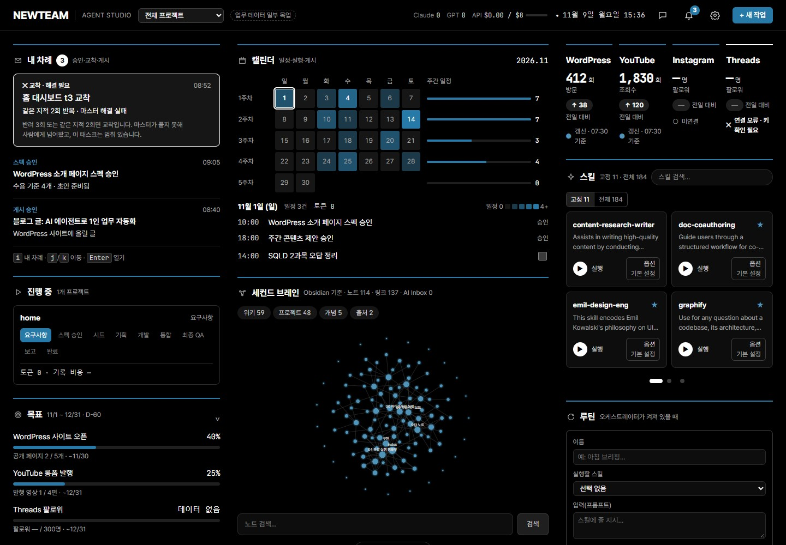
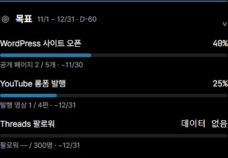
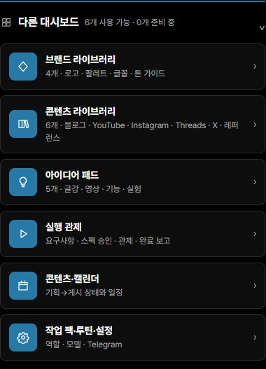
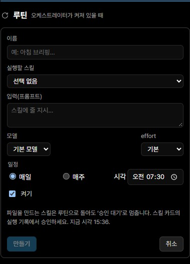
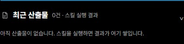

# NEWTEAMs

> 여러 AI 에이전트의 작업을 관제하고, 사람이 개입할 순간과 결과의 근거를 한 화면에서 확인하는 로컬 운영 시스템입니다.

[제품 정의](PRODUCT.md) · [사용자 시나리오](docs/scenarios/2026-10-28-user-scenarios.md) · [운영 의사결정](docs/decisions.md) · [보안 원칙](docs/security.md)



<sub>2026년 11월 9일 로컬 `main` 실행 화면입니다. 사용량은 실제 실행 기록이며, 홈의 일부 업무 데이터는 예시입니다.</sub>

## 이 README에서 확인할 내용

| 궁금한 점 | 바로가기 |
| --- | --- |
| 어떤 문제를 해결하나 | [프로젝트 개요](#프로젝트-개요) |
| 에이전트와 사람은 어떻게 협업하나 | [운영 흐름](#운영-흐름) |
| 실제 화면은 어떤가 | [제품 둘러보기](#제품-둘러보기) |
| 결과를 어떻게 신뢰하나 | [신뢰를 만드는 설계](#신뢰를-만드는-설계) |
| 직접 실행하려면 | [로컬 실행](#로컬-실행) |

## 프로젝트 개요

AI 에이전트가 기획부터 개발과 검수까지 맡더라도 사용자의 일이 사라지지는 않습니다. 작업이 보이지 않으면 진행 상태, 반복 오류, 개입 시점, 완료 근거를 계속 확인해야 합니다.

NEWTEAMs는 더 많은 알림 대신 더 적은 개입으로도 안심할 수 있는 운영 경험을 설계합니다. 시스템은 평소 조용히 일하고, 사람의 판단이 필요한 순간만 분명하게 드러냅니다.

| 구분 | 내용 |
| --- | --- |
| 사용자 | 여러 AI 에이전트의 작업을 혼자 운영하는 기획·개발 실무자 |
| 핵심 문제 | 진행 불안, 개입 피로, 반복 비용, 결과에 대한 불신 |
| 핵심 경험 | 관제 → 필요한 순간만 개입 → 근거를 따라 결과 검증 |
| 기술 | React, TypeScript, Vite, Node.js, Fastify, Vitest, Playwright |
| 현재 단계 | 로컬 프로토타입, 실제 사용자 성과 측정 전 |

## 운영 흐름

```text
사용자가 목표와 제약을 등록
          ↓
Claude가 작업하고 GPT가 읽기 전용 검토
          ↓
자동화 가능한 결정은 정책에 따라 계속 진행
          ↓
사람의 판단이 필요하면 결정 큐에 근거와 함께 표시
          ↓
승인·수정·중단 후 실행 재개
          ↓
테스트, 로그, 산출물을 연결해 완료 근거 확인
```

사람은 사양 승인과 교착 상태처럼 되돌리기 어렵거나 정책으로 해결할 수 없는 순간에만 개입합니다. 목표는 첫 화면에서 현재 상태를 10초 안에, 판단이 필요한 이유를 30초 안에 파악하게 하는 것입니다. 이 시간은 측정된 성과가 아니라 설계 기준입니다.

## 제품 둘러보기

### 목표



기간과 현재 수치를 함께 보여 줍니다. 데이터가 연결되지 않은 목표는 임의의 진행률 대신 `데이터 없음`으로 표시합니다.

### 다른 대시보드



에이전트 설정, 실행 기록, Vault, Telegram처럼 운영 목적이 다른 화면으로 이동합니다. 홈은 요약에 집중하고 세부 제어는 전용 화면에 둡니다.

### 루틴



반복 작업의 주기, 최근 실행, 다음 실행을 한곳에서 확인합니다. 자동화가 멈춘 경우에도 사용자가 놓치지 않도록 상태를 드러냅니다.

### 최근 산출물



완료 보고만 보여 주지 않고 실행 기록과 결과 파일로 이어지는 경로를 제공합니다. 사용자는 요약에서 원본 근거까지 단계적으로 내려갈 수 있습니다.

## 신뢰를 만드는 설계

| 설계 | 사용자에게 주는 가치 |
| --- | --- |
| 작업 모델과 검토 모델 분리 | 같은 관점이 오류를 반복할 가능성 완화 |
| 결정 큐에 이유와 근거 연결 | 무엇을 판단해야 하는지 빠르게 파악 |
| 요약에서 로그·테스트·산출물로 이동 | 완료 주장을 원본으로 검증 가능 |
| 일시정지와 비용 상태 상시 노출 | 예상치 못한 실행과 사용량을 통제 |
| 알림과 확인 단계를 위험도에 따라 구분 | 일상 작업은 방해하지 않고 중요한 결정은 재확인 |
| Vault와 민감 정보 정책 분리 | 운영 화면에 비밀 정보가 노출되는 위험 완화 |

## 검증 상태

2026년 11월 2일 기준으로 다음 검증을 통과했습니다. 이는 제품 동작을 확인한 결과이며 실제 사용자의 시간 절감이나 만족도를 뜻하지 않습니다.

- 오케스트레이터 테스트 414개 통과, Windows 심볼릭 링크 관련 1개 건너뜀
- 대시보드 테스트 174개 통과
- 대시보드 프로덕션 빌드 성공
- 핵심 사용자 시나리오와 예외 흐름 문서화

## 시스템 구조

```text
React Dashboard
  ├─ 홈·결정 큐·실행 기록
  ├─ 에이전트·Vault·Telegram 설정
  └─ SSE 실시간 상태 + REST 제어
              │
Node.js Orchestrator
  ├─ 작업·검토 모델 라우팅
  ├─ 승인·중단·재시도 정책
  ├─ 비용·증거·로그 수집
  └─ 로컬 파일 기반 실행 상태
```

## 로컬 실행

Node.js 20 이상이 필요합니다.

```bash
npm install
npm --prefix orchestrator install
npm --prefix dashboard install
npm run dev
```

실제 모델 호출, Telegram 연결, Vault 경로는 로컬 설정이 필요합니다.

```bash
npm test
npm run build
```

## 문서 안내

README는 제품을 빠르게 이해하기 위한 시작점입니다. 세부 개념, 운영 규칙, 설정 방법은 기존 문서에서 이어집니다.

| 유형 | 문서 | 용도 |
| --- | --- | --- |
| 개념 | [제품 정의](PRODUCT.md) | 사용자, 문제, 핵심 원칙 |
| 개념 | [디자인 원칙](DESIGN.md) | 화면과 상호작용 기준 |
| 가이드 | [스킬과 루틴](docs/skills-and-routines.md) | 반복 작업 구성과 운영 |
| 가이드 | [Vault 설정](docs/vault-setup.md) | 로컬 문서 저장소 연결 |
| 참고 | [사용자 시나리오](docs/scenarios/2026-10-28-user-scenarios.md) | 정상·예외 흐름과 성공 기준 |
| 참고 | [운영 의사결정](docs/decisions.md) | 정책과 선택의 근거 |
| 참고 | [보안 원칙](docs/security.md) | 민감 정보와 접근 범위 |

## 현재 한계

- 홈 화면의 일부 업무 데이터는 실제 사용자 데이터가 아닌 예시입니다.
- 사용자의 개입 시간, 완료 신뢰도, 운영 비용 변화는 아직 측정하지 않았습니다.
- 모델 제공자와 외부 연동 상태에 따라 일부 기능을 사용할 수 없습니다.
- 장시간 실행과 다수 프로젝트 동시 운영은 추가 검증이 필요합니다.
